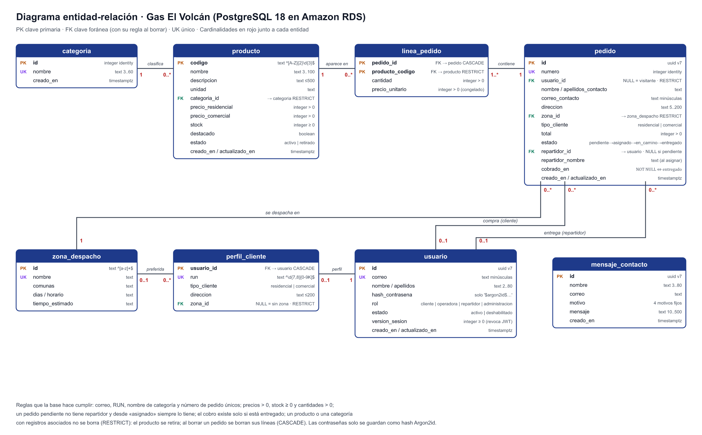
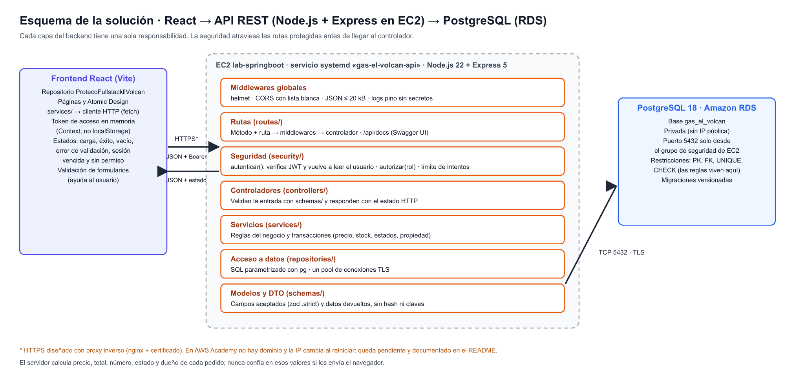
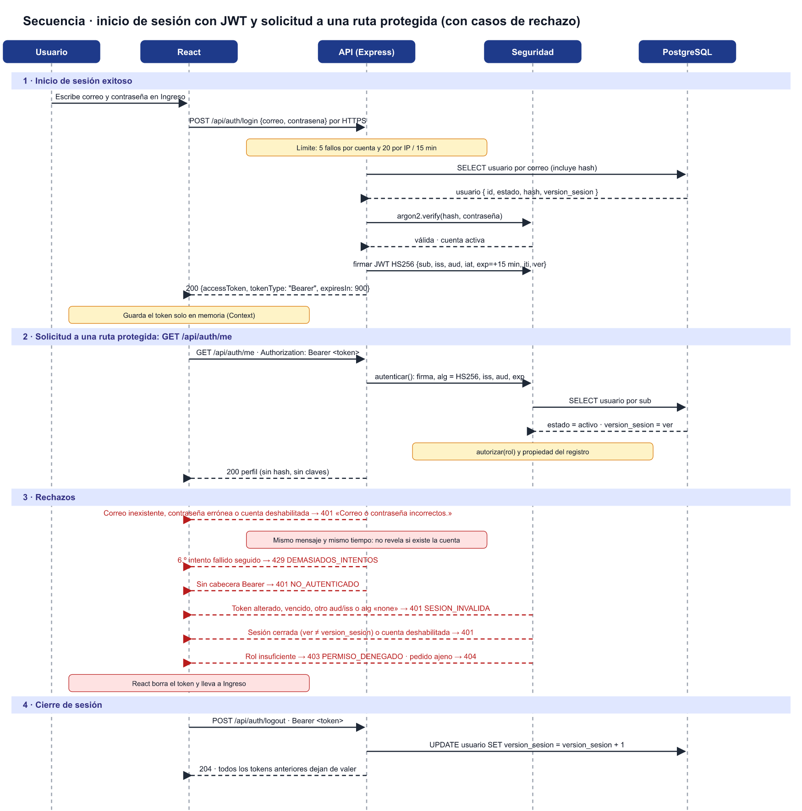

# Backend · Distribuidora de Gas El Volcán

API REST del proyecto semestral de **DSY1104 Desarrollo Fullstack II** (Duoc UC, sección 006D).
Plan de trabajo de la Guía 18: backend, base de datos e inicio de sesión con JWT.

> **Estado al 11-nov-2026 (semana 1 de 2):** estructura, conexión a PostgreSQL, esquema completo, semillas,
> autenticación JWT completa y catálogo de lectura **implementados y probados** (24 de 24 pruebas aprobadas).
> El resto de los contratos está **diseñado** y marcado como `propuesto` en Swagger. Ver [Estado del trabajo](#9-estado-del-trabajo).

## Contenido
1. [Identificación y alcance](#1-identificación-y-alcance)
2. [Referencia al frontend](#2-referencia-al-frontend)
3. [Decisiones técnicas](#3-decisiones-técnicas)
4. [Diseño de datos](#4-diseño-de-datos)
5. [Organización y responsabilidades](#5-organización-y-responsabilidades)
6. [API y documentación viva](#6-api-y-documentación-viva)
7. [Seguridad](#7-seguridad)
8. [Cómo ejecutar y comprobar el avance](#8-cómo-ejecutar-y-comprobar-el-avance)
9. [Estado del trabajo](#9-estado-del-trabajo)
10. [Checklist final](#10-checklist-final)
11. [Fuentes consultadas](#11-fuentes-consultadas)

---

## 1. Identificación y alcance

| | |
|---|---|
| **Proyecto** | Distribuidora de Gas El Volcán (caso Forma C) |
| **Caso** | La distribuidora recibe entre 80 y 120 pedidos diarios por teléfono, anotados en cuadernos: duplicados, pedidos no atendidos, stock sin visibilidad y cobros sin registro. |
| **Asignatura y sección** | DSY1104 Desarrollo Fullstack II · 006D |
| **Integrantes** | Vicente Hueichapan (equipo de una persona) |

**Funcionalidades que cubrirá el backend** (requisitos del ERS V2):

- Catálogo y detalle con tarifa residencial y comercial (RF02–RF05).
- Registro, inicio y cierre de sesión con JWT, y perfil (RF07, RF25).
- Operación principal: confirmar un pedido con precio vigente y descuento de stock (RF09, RF10, RF16).
- Seguimiento con número y correo, y «Mis pedidos» (RF11, RF12).
- Operadora y repartidor: asignar y avanzar estados con registro del cobro (RF13–RF15).
- Administración de productos, categorías, usuarios y roles, productos críticos y reportes (RF17–RF24).
- Mensajes de contacto (RF06).

El carrito sigue guardándose en el navegador: no necesita persistir en el servidor hasta que se confirma el pedido.

## 2. Referencia al frontend

- **Repositorio de la interfaz (React + Vite):** https://github.com/vicenteehueichapan-boop/ProtecoFullstackllVolcan
- El README del frontend enlaza a este repositorio. El frontend se mantiene en su propio repositorio, como pide la guía.

## 3. Decisiones técnicas

**Tecnología y ejecución son decisiones distintas:** el backend usa **Node.js + Express** (framework) y se
ejecuta en **Amazon EC2** (infraestructura).

| Pieza | Elección | Justificación |
|---|---|---|
| Lenguaje y framework | **Node.js 22 LTS + Express 5** | Mismo lenguaje que el frontend React; ya usado en las guías 17–18. Node 22 tiene soporte LTS (el Node 18 de Ubuntu ya no). |
| Ejecución | **EC2** `lab-springboot` (Ubuntu 24.04, t3.small) | Proceso siempre activo con el servicio **systemd** [`deploy/gas-el-volcan-api.service`](deploy/gas-el-volcan-api.service): arranca con la instancia y se reinicia ante un fallo. Recibe HTTP por el puerto configurado, abierto solo para «Mi IP» en el grupo de seguridad. |
| Base de datos | **PostgreSQL 18 en Amazon RDS** (`gas-el-volcan-db`) | Relacional: el caso tiene relaciones fuertes (pedido–líneas–producto, usuario–rol). RDS administra respaldos y parches. La base es **privada** (sin IP pública) y solo acepta el puerto 5432 desde el grupo de seguridad de EC2. Datos en la base `gas_el_volcan`; las pruebas usan `gas_el_volcan_test`. |
| Acceso a datos | **`pg`** con SQL parametrizado y **migraciones SQL versionadas** (`migrations/`, ejecutadas por [`src/config/migraciones.js`](src/config/migraciones.js)) | SQL visible y explicable, sin ORM. Cada migración corre en una transacción. Se descartó `node-pg-migrate` porque traía 3 vulnerabilidades moderadas (`glob`, `minimatch`). |
| Validación | **`zod`** | Valida y tipa los DTO de entrada; `.strict()` rechaza campos no permitidos (por ejemplo, `rol` en el registro). |
| Contraseñas | **Argon2id** con **`argon2`** | Ver [7.1](#71-contraseñas). |
| JWT | **`jose`** (HS256) | Ver [7.2](#72-flujo-jwt). |
| Documentación viva | **OpenAPI 3.1** ([`docs/openapi.yaml`](docs/openapi.yaml)) + **`swagger-ui-express`** | La especificación vive junto al código y Swagger UI permite probar las rutas implementadas. |
| Pruebas | **Vitest + Supertest** | El mismo Vitest del frontend; las pruebas de integración usan una base PostgreSQL real de pruebas. |
| Seguridad HTTP | **`helmet`**, **`cors`** (lista blanca), **`express-rate-limit`**, **`pino`** (con ocultamiento de datos) | Cabeceras seguras, orígenes permitidos, límite de intentos de ingreso y registros sin contraseñas ni tokens. |
| Calidad | **`oxlint`** y `npm audit` | Igual que el frontend. Estado actual: 0 advertencias y 0 vulnerabilidades. |

**Alternativa evaluada:** Lambda + API Gateway. Se descartó en esta etapa porque agrega piezas (rutas en API Gateway, funciones en VPC, Swagger aparte) sin beneficio para el volumen del caso, de unos 120 pedidos al día.

## 4. Diseño de datos

- **Diagrama entidad-relación (Drive):** **PENDIENTE: pegar aquí el enlace de Drive** (carpeta `DSY1104 · Gas El Volcán · Backend`, compartida como «Cualquier persona con el enlace: Lector»).
- Copia en el repositorio: [`docs/diagramas/diagrama-entidad-relacion.svg`](docs/diagramas/diagrama-entidad-relacion.svg)



El esquema completo está en [`migrations/1731340800000_esquema-inicial.sql`](migrations/1731340800000_esquema-inicial.sql).

### Relaciones y decisiones que necesitan justificación

- **`usuario` y `perfil_cliente` (1 a 0..1):** todos los roles comparten la tabla `usuario`. Los datos que solo tiene un cliente (RUN, tipo de cliente, dirección y zona preferida) van en `perfil_cliente`, para no dejar columnas vacías en el personal.
- **`pedido.usuario_id` admite NULL** porque el ERS permite que un **visitante compre sin cuenta**. Los datos de contacto y entrega se guardan en el propio pedido, porque la dirección puede cambiar después.
- **`linea_pedido.precio_unitario` congelado:** si cambia una tarifa, los pedidos anteriores conservan su precio.
- **IDs públicos UUIDv7** (`uuidv7()` de PostgreSQL 18) para usuario y pedido: van en URLs y no se pueden adivinar ni revelan cuántos registros hay. El `numero` del pedido es solo para mostrar, y el seguimiento exige además el correo.
- **Estados como texto con `CHECK`**, no como booleanos: el usuario es `activo` o `deshabilitado`, el producto `activo` o `retirado`, y el pedido sigue la secuencia del ERS.
- **Pesos chilenos en enteros:** el CLP no tiene decimales.

### Reglas de integridad (las aplica la base de datos)

| Regla | Cómo se aplica |
|---|---|
| No se duplican | `UNIQUE` en correo, RUN, nombre de categoría y número de pedido; el código de producto es PK. |
| Montos y cantidades válidos | `CHECK`: precios > 0, stock ≥ 0, cantidad > 0, total > 0. |
| Formatos | `CHECK` con expresión regular: código `^[A-Z]{2}\d{3}$`, RUN, correo en minúsculas y hash `$argon2id$…`. |
| Relaciones obligatorias | `NOT NULL` + `FOREIGN KEY` (producto → categoría, línea → producto y pedido, pedido → zona). |
| Coherencia del pedido | Un pedido pendiente no tiene repartidor y desde «asignado» siempre lo tiene; el cobro existe si y solo si está entregado. |
| Al eliminar | **RESTRICT** en categoría, producto, zona y usuario: un registro con historial no se borra (el producto se retira y el usuario se deshabilita). **CASCADE** de pedido a sus líneas y de usuario a su perfil. |
| Al menos un administrador activo (regla 8 del ERS) | Se aplica en el servicio de usuarios dentro de una transacción con bloqueo de fila (diseñado, semana 2). |

### De los datos simulados a datos iniciales

- `seeds/catalogo.js` se **generó desde `src/data/` del frontend** (14 productos del Excel, 5 zonas y los destacados CL002, MG004 y AC003), sin copiar a mano.
- `npm run sembrar` carga zonas, categorías, productos y los **5 perfiles ficticios del personal** de la demostración (`@ejemplo.cl`). Su contraseña llega desde la variable `SEMILLA_CONTRASENA_DEMO`; ninguna credencial está en el repositorio.
- Las semillas se pueden ejecutar varias veces (`ON CONFLICT DO NOTHING`) y no pisan cambios posteriores.
- **Persiste tras reiniciar el backend:** todo lo de la base (usuarios, catálogo, pedidos, mensajes). No persiste el carrito (vive en el navegador) ni el token, que se pierde al recargar y obliga a ingresar de nuevo.

## 5. Organización y responsabilidades

- **Esquema React–API–BD (Drive):** **PENDIENTE: pegar aquí el enlace de Drive**.
- Copia: [`docs/diagramas/esquema-react-api-bd.svg`](docs/diagramas/esquema-react-api-bd.svg)



| Capa | Carpeta | Responsabilidad |
|---|---|---|
| Rutas HTTP | `src/routes/` | Asocian método + ruta con sus middlewares y su controlador. |
| Controladores | `src/controllers/` | Reciben la solicitud, validan la entrada con su esquema y responden con el estado HTTP correspondiente. |
| Servicios | `src/services/` | Reglas del negocio y operaciones que deben completarse juntas (transacciones). |
| Acceso a datos | `src/repositories/` | Consultas SQL parametrizadas. |
| Modelos y DTO | `src/schemas/` + esquema SQL | Campos aceptados en la entrada y datos devueltos (sin hash ni claves). |
| Seguridad | `src/security/` | Hash de contraseñas, emisión y verificación de JWT, `autenticar()`, `autorizar(rol)` y límite de intentos. |
| Configuración y errores | `src/config/`, `src/errores/` | Variables de entorno validadas al arrancar, conexión TLS, migraciones y formato único de error. |

**Responsabilidades del integrante:** Vicente Hueichapan asume diseño, desarrollo, pruebas, despliegue y documentación de todas las capas.

### Operación completa: confirmar un pedido

**React** (`ConfirmarPedido`, `services/pedidoService.crearPedido`) → `POST /api/pedidos` → **controlador** (valida forma) → **servicio** (reglas y transacción) → **repositorio** (SQL) → **PostgreSQL** → `201` con número → `PedidoExitoso`.

| Validación | Responsable |
|---|---|
| Campos obligatorios, formatos, cantidad entera > 0, zona y tarifa válidas | Controlador con `schemas/` (400) |
| Producto existe y está activo; precio vigente según la tarifa; stock suficiente (`UPDATE … WHERE stock >= cantidad`); todo o nada | Servicio, en una transacción (409 si falta stock) |
| Dueño del pedido = usuario del token (o visitante sin cuenta) | Seguridad + servicio |
| Precios > 0, cantidades > 0, coherencia de estado | Base de datos (`CHECK`, última línea de defensa) |

- **El cliente envía:** líneas (`codigo` y `cantidad`), nombre, apellidos, correo, dirección, zona y tipo de cliente (si tiene sesión, se usa el de su perfil).
- **El servidor calcula:** precio unitario, total, número, estado inicial (`pendiente`), fecha y dueño. El frontend nunca decide el precio final, el rol ni la propiedad de un registro.

## 6. API y documentación viva

**Swagger UI:** `http://<IP pública de EC2>:<PUERTO>/api/docs` · **OpenAPI en JSON:** `/api/openapi.json`

Cómo abrirlo: encender `lab-springboot`, copiar su IPv4 pública (cambia al reiniciar el laboratorio), confirmar
que el grupo de seguridad permite el puerto de la API desde «Mi IP» y abrir la URL en el navegador. Para probar
una ruta protegida: ejecutar `POST /api/auth/login` con «Try it out», copiar `accessToken`, presionar
**Authorize** y pegarlo. Cada operación indica `x-estado` (`implementado` o `propuesto`), `x-pantalla`,
`x-entidades` y `x-permisos`.

| Recurso | Operaciones | Pantalla de React | Estado |
|---|---|---|---|
| Autenticación | `POST /api/auth/register` · `POST /api/auth/login` · `GET /api/auth/me` · `POST /api/auth/logout` | Registro, Ingreso, Acceso del personal, barra | **Implementado y probado** |
| Autenticación | `PATCH /api/auth/me` (editar nombre) | Perfil de administración | Propuesto |
| Productos | `GET /api/productos` (búsqueda y categoría) · `GET /api/productos/{codigo}` | Catálogo, Categorías, Destacados, Detalle | **Implementado y probado** |
| Productos | `POST` · `PUT /{codigo}` · `DELETE /{codigo}` (409 si tiene pedidos) · `PATCH /{codigo}/stock` | Administración › Productos y Críticos | Propuesto (semana 2) |
| Categorías | `GET` · `POST` · `PUT /{id}`. Sin `DELETE`: el ERS solo pide crear y editar | Catálogo, Administración › Categorías | Propuesto |
| Zonas | `GET /api/zonas` | Inicio, Registro, Confirmar pedido | Propuesto |
| Pedidos | `POST /api/pedidos` · `GET /api/pedidos/mios` | Confirmar pedido, Mis pedidos | Propuesto (semana 2) |
| Pedidos | `POST /api/pedidos/seguimiento` · `GET /api/pedidos/{id}` · `GET /api/pedidos` · `GET /api/pedidos/asignados` · `PATCH /{id}/asignacion` · `PATCH /{id}/estado` | Seguimiento, Operadora, Repartidor, Administración › Pedidos | Propuesto |
| Usuarios | `GET` · `POST` (crea personal con rol) · `GET /{id}` · `PATCH /{id}` | Administración › Usuarios | Propuesto |
| Mensajes | `POST` (público) · `GET` (administración) | Contacto | Propuesto |
| Reportes | `GET /api/reportes/resumen` | Panel y Reportes | Propuesto |

**Formato de error único:** `{ "error": { "codigo": "VALIDACION", "mensaje": "…", "detalles": { "campo": "…" } } }`.
Estados: 200/201/204 (éxito), 400 (validación o JSON inválido), 401 (credenciales o token), 403 (sin permiso),
404 (no existe o pedido ajeno), 409 (conflicto: duplicado, stock o estado) y 429 (demasiados intentos).

### Ejemplos (datos ficticios)

`POST /api/auth/register` (todos los campos los envía el cliente):
```json
{ "nombre": "Ana", "apellidos": "Pérez Soto", "run": "12345678K", "correo": "ana@ejemplo.cl",
  "contrasena": "Ficticia2026", "tipoCliente": "residencial", "direccion": "Av. Libertad 123", "zonaId": "centro" }
```
`201` (todo lo genera el servidor, sin contraseña ni hash):
```json
{ "id": "019a6f2c-1d2e-7c3b-9a10-5b6c7d8e9f00", "correo": "ana@ejemplo.cl", "nombre": "Ana",
  "apellidos": "Pérez Soto", "rol": "cliente" }
```
`POST /api/auth/login` → `200`:
```json
{ "accessToken": "eyJhbGciOiJIUzI1NiIsInR5cCI6IkpXVCJ9.…", "tokenType": "Bearer", "expiresIn": 900 }
```
`401` (igual si el correo no existe o la contraseña es incorrecta):
```json
{ "error": { "codigo": "CREDENCIALES_INVALIDAS", "mensaje": "Correo o contraseña incorrectos." } }
```

### Cómo cambia el frontend (paso 2 de la guía)

| Función actual en `services/` | Pasará a consultar |
|---|---|
| `productoService.listarProductos`, `obtenerProductoPorCodigo` | `GET /api/productos`, `GET /api/productos/{codigo}` |
| `productoService.crearProducto`, `actualizarProducto`, `eliminarProducto` | `POST`, `PUT`, `DELETE /api/productos…` |
| `categoriaService.listarCategorias`, `crearCategoria`, `actualizarCategoria` | `/api/categorias` |
| `clienteService.registrarCliente`, `iniciarSesionCliente`, `cerrarSesionCliente`, `leerSesionCliente` | `/api/auth/register`, `/login`, `/logout`, `/me` |
| `personalService.buscarPersonalActivoPorCorreo` (acceso del personal) | `POST /api/auth/login` (el rol lo devuelve `/me`) |
| `personalService.listarPersonal`, `crearPersonal`, `actualizarPersonal`; `clienteService.listarClientes` | `/api/usuarios` |
| `pedidoService.crearPedido`, `listarPedidos`, `obtenerPedidoPorId` | `POST /api/pedidos`, `GET /api/pedidos…` |
| `pedidoService.asignarRepartidor`, `cambiarEstadoPedido` | `PATCH /api/pedidos/{id}/asignacion`, `/estado` |
| `mensajeService.crearMensaje`, `listarMensajes` | `/api/mensajes` |
| `carritoService.*` | Sin cambio: sigue en el navegador |

**Estados de la interfaz:** *carga* (indicador y botón deshabilitado), *éxito*, *vacío* («No hay productos»
o «Aún no tienes pedidos»), *error de validación* (los `detalles` del 400 se muestran junto a cada campo, como ya
hace `CampoFormulario`), *sesión vencida* (401 → se borra el token y se lleva a Ingreso con un aviso) y
*sin permiso* (403 → mensaje y regreso al inicio). Las validaciones de React siguen ayudando al usuario; el
backend valida todo de nuevo.

## 7. Seguridad

### 7.1 Contraseñas

- **Algoritmo: Argon2id**, ganador de la Password Hashing Competition y primera opción de OWASP. Es *lento a propósito* y *exigente en memoria*, lo que encarece los ataques con GPU. **MD5 y SHA-x quedan descartados**: son rápidos y no se diseñaron para contraseñas.
- **Biblioteca:** [`argon2`](https://www.npmjs.com/package/argon2) (enlace a la implementación oficial en C).
- **Configuración:** `m = 19 MiB, t = 2, p = 1` (mínimo recomendado por OWASP), con sal aleatoria por contraseña incluida en el hash.
- La base **solo acepta** valores que empiezan con `$argon2id$` (`CHECK`); la contraseña en texto plano nunca se guarda, nunca se registra y nunca se devuelve.
- **Largo:** de 8 a 128 caracteres (NIST SP 800-63B). Pendiente en React: hoy el formulario pide 6.
- **Alternativa válida:** bcrypt (costo ≥ 10), si Argon2id no estuviera disponible.

### 7.2 Flujo JWT

- **Diagrama de secuencia (Drive):** **PENDIENTE: pegar aquí el enlace de Drive** · copia: [`docs/diagramas/secuencia-jwt.svg`](docs/diagramas/secuencia-jwt.svg)



| Decisión | Valor y justificación |
|---|---|
| Quién emite y verifica | Esta misma API. Por eso basta una clave simétrica. |
| Algoritmo | **HS256**, en lista blanca: un token con `alg: none` u otro algoritmo se rechaza (probado). |
| Clave | 32 bytes aleatorios en `JWT_SECRETO`, solo en el `.env` del servidor (permisos 600). Nunca en React ni en el repositorio. |
| Campos del token | `sub` (id del usuario), `iss`, `aud`, `iat`, `exp`, `jti` (id único del token) y `ver` (versión de sesión, para revocar). **No incluye el rol** ni datos personales: el rol se lee de la base en cada solicitud, así un cambio de rol o una cuenta deshabilitada rige al instante. |
| Verificación | Firma, algoritmo, `iss`, `aud`, `exp` y campos obligatorios con `jose.jwtVerify`. Decodificar no basta. |
| Vigencia | **15 minutos.** Limita la ventana de uso de un token robado. Sin refresh token en esta versión: al vencer se vuelve a ingresar, como permite la guía. |
| Cierre de sesión | `POST /api/auth/logout` incrementa `version_sesion`, así que **todos** los tokens emitidos de ese usuario dejan de valer de inmediato (probado). |
| Cuenta deshabilitada | El token se rechaza en la siguiente solicitud, aunque no haya vencido (probado). |
| Token en el frontend | En memoria (Context de React), no en `localStorage`. Al recargar se pide ingresar de nuevo. Sin cookies, por lo que no aplica CSRF. |
| Rechazos | 401 genérico ante credenciales incorrectas, sin revelar si la cuenta existe (mismo mensaje y mismo tiempo de respuesta, gracias a un hash de relleno). |

### 7.3 Controles

| Control | Estado |
|---|---|
| Límite de intentos de ingreso: 5 fallidos por cuenta y 20 por IP cada 15 min → 429 | Implementado y probado |
| Validación de entrada en todas las rutas implementadas (zod `.strict()`) | Implementado y probado |
| Logs JSON con ocultamiento de `Authorization`, contraseñas y tokens | Implementado |
| CORS limitado a `ORIGENES_PERMITIDOS` (hoy `http://localhost:5173`). CORS no reemplaza la autorización | Implementado |
| Cabeceras seguras (`helmet`), cuerpo JSON ≤ 20 kB | Implementado |
| Conexión a la base cifrada con TLS y certificado verificado | Implementado |
| **HTTPS** para credenciales y tokens | **Diseñado, pendiente:** proxy inverso nginx en el puerto 443 con certificado. AWS Academy no entrega dominio y la IP pública cambia al reiniciar, así que hoy la API usa HTTP solo con «Mi IP». |

### 7.4 Roles y permisos

Roles del ERS: **visitante** (sin cuenta), **cliente**, **operadora**, **repartidor** y **administración**.
El backend comprueba el permiso en **cada solicitud** (ocultar botones en React no basta).

| Operación | Visitante | Cliente | Operadora | Repartidor | Administración |
|---|---|---|---|---|---|
| Ver catálogo, zonas, seguimiento con número y correo, enviar contacto | Sí | Sí | Sí | Sí | Sí |
| Registrarse | Sí (solo como cliente) | — | — | — | — |
| Confirmar pedido | Sí (sin dueño) | Sí (queda a su nombre) | — | — | — |
| Ver un pedido por id | — | **Solo los propios** | Todos | **Solo los asignados** | Todos |
| Mis pedidos | — | Los propios | — | — | — |
| Asignar repartidor | — | — | Sí | — | — |
| Avanzar estado y registrar cobro | — | — | — | **Solo sus pedidos** | — |
| Productos, categorías, stock, reportes, mensajes | — | — | — | — | Sí |
| Crear personal, asignar roles, deshabilitar | — | — | — | — | Sí (debe quedar al menos un administrador activo) |

**Regla anti-IDOR** (no ver ni modificar datos de otra persona cambiando el id en la URL): la consulta incluye
al dueño, por ejemplo `WHERE id = $1 AND usuario_id = $2`, con `$2` tomado **del token**. Si el pedido no es
suyo responde **404** (no confirma que exista). El historial usa `/api/pedidos/mios`, sin id en la URL.
**Quién asigna roles:** solo administración, mediante `POST`/`PATCH /api/usuarios`. El registro público no acepta
el campo `rol` (400, probado) y siempre crea un cliente.

## 8. Cómo ejecutar y comprobar el avance

### Requisitos

- Node.js 22.12 o superior y npm.
- PostgreSQL 18 (Amazon RDS) accesible desde la máquina que ejecuta la API (en este proyecto, la EC2 en la misma VPC).
- Certificado de RDS: `https://truststore.pki.rds.amazonaws.com/us-east-1/us-east-1-bundle.pem`

### Configuración (sin valores secretos)

Copiar [`.env.example`](.env.example) como `.env` (y como `.env.test` con `DB_NAME=gas_el_volcan_test`) y
completar los valores. La API **no arranca** si falta una variable o si la clave JWT tiene menos de 32 bytes.

### Pasos en EC2

```bash
git clone https://github.com/vicenteehueichapan-boop/BackendStackll.git && cd BackendStackll
```

```bash
npm ci
```

```bash
npm run migrar
```

```bash
npm run sembrar
```

```bash
sudo cp deploy/gas-el-volcan-api.service /etc/systemd/system/ && sudo systemctl daemon-reload && sudo systemctl enable --now gas-el-volcan-api
```

Para comprobar: `systemctl status gas-el-volcan-api` y abrir `http://<IP pública>:<PUERTO>/api/docs`.
Para desarrollo: `npm run dev`.

### Pruebas

```bash
npm test
```

```bash
npm run lint
```

Las pruebas de integración se ejecutan contra la base `gas_el_volcan_test`. El script se niega a correr si el
nombre de la base no termina en `_test`.

### Resultados reales (11-nov-2026, en EC2 contra RDS)

`npm test`: **3 archivos, 24 pruebas aprobadas** · `npm run lint`: 0 advertencias · `npm audit`: 0 vulnerabilidades.

| Caso de la guía | Esperado | Obtenido |
|---|---|---|
| Login válido | 200 con token Bearer y `expiresIn` 900 | ✅ Igual |
| Login inválido (clave errónea y correo inexistente) | 401 con el mismo cuerpo | ✅ Cuerpos idénticos |
| 6.º intento fallido de la misma cuenta | 429 | ✅ 429 `DEMASIADOS_INTENTOS` |
| Ruta protegida sin token | 401 | ✅ 401 `NO_AUTENTICADO` |
| Token alterado | 401 | ✅ 401 |
| Token vencido, otro `aud` o `alg: none` | Rechazo | ✅ Rechazado (prueba unitaria) |
| Rol insuficiente | 403 | ✅ 403 `PERMISO_DENEGADO` |
| Registro inválido | 400 con detalle por campo | ✅ correo, contraseña y RUN señalados |
| Registro con `rol: administracion` | Rechazo | ✅ 400 |
| Registro duplicado | 409 y sin usuario duplicado | ✅ 409, `count = 1` |
| Cierre de sesión | El token deja de servir | ✅ 401 tras el logout |
| Cuenta deshabilitada | Pierde el acceso con token vigente | ✅ 401 en `/me` y en el login |
| `/me` | Perfil del dueño del token, sin hash | ✅ Igual |
| Catálogo: lista, filtros, detalle, 404 y 400 | Según el contrato | ✅ 14 productos; filtros, 404 y 400 correctos |
| Hash guardado | `$argon2id$v=19$m=19456,t=2,p=1$…`, distinto en cada caso | ✅ Igual |
| Swagger UI y OpenAPI | 200 | ✅ Igual |

**Casos pendientes** (se probarán al implementar su endpoint): acceso a pedidos ajenos (404), conflicto de
negocio por stock insuficiente al confirmar un pedido (409), borrar un producto con pedidos (409), integración
en el navegador con React (carga, éxito, error y sesión vencida con Vitest y mocks del cliente HTTP).

## 9. Estado del trabajo

| Área | Diseñado | Implementado | Probado |
|---|---|---|---|
| Decisiones técnicas, ER, esquema, roles y permisos, secuencia JWT | ✅ | — | — |
| Estructura del proyecto, configuración validada y conexión TLS a RDS | ✅ | ✅ | ✅ |
| Esquema completo (8 tablas) con migraciones y semillas desde el frontend | ✅ | ✅ | ✅ |
| Autenticación: register, login, me, logout, límite de intentos y revocación | ✅ | ✅ | ✅ |
| Catálogo: listar y detalle | ✅ | ✅ | ✅ |
| Swagger UI / OpenAPI con todos los contratos | ✅ | ✅ | ✅ |
| Servicio systemd en EC2 | ✅ | ✅ | ✅ (activo, responde 200) |
| CRUD de productos (administración), crear pedido, mis pedidos | ✅ | Semana 2 | — |
| Resto de contratos (categorías, zonas, operadora, repartidor, usuarios, mensajes, reportes) | ✅ | Pendiente | — |
| Integración del frontend (cliente HTTP, token en memoria, estados de la interfaz) | ✅ | Semana 2 | — |
| HTTPS con proxy inverso | ✅ | Pendiente (limitación del laboratorio) | — |

**Dificultades:**
- `node-pg-migrate` traía vulnerabilidades: se reemplazó por un ejecutor de migraciones propio y transaccional.
- Node 18 de Ubuntu sin soporte: se instaló Node 22 LTS.
- La IP pública de EC2 y la de salida del equipo cambian al reiniciar el laboratorio, lo que obliga a actualizar las reglas «Mi IP».
- Sin dominio en AWS Academy: HTTPS queda diseñado y no implementado.

**Próximos pasos (semana 2, 18–25 nov):**
1. `POST`/`PUT`/`DELETE /api/productos` con su prueba de 409.
2. `POST /api/pedidos` transaccional y `GET /api/pedidos/mios`, con las pruebas de stock insuficiente y de pedido ajeno.
3. Frontend: cliente HTTP en `services/`, token en memoria, login, catálogo y estados de la interfaz, con mínimo de 8 caracteres en la contraseña.
4. Actualizar Swagger (`x-estado`), este README y el checklist.

## 10. Checklist final

- [x] Creamos un repositorio nuevo para el backend y conservamos separado el frontend.
- [x] El README identifica proyecto, caso, alcance e integrantes.
- [ ] El README del backend enlaza al frontend y el del frontend enlaza al backend. *(Este README enlaza al frontend; falta integrar el enlace en el README del frontend.)*
- [x] Justificamos la tecnología elegida y su ejecución en EC2.
- [x] Definimos la base de datos y mantenemos su diagrama actualizado, sin diccionario de datos.
- [ ] Los diagramas en Drive tienen enlaces directos y acceso de lectura para el docente. *(Pendiente: subir y pegar los enlaces.)*
- [x] Explicamos las responsabilidades del backend y de los integrantes.
- [x] Iniciamos la estructura del proyecto, la conexión a datos y los primeros endpoints; indicamos el estado real de cada avance.
- [x] Documentamos la API con OpenAPI/Swagger y explicamos cómo consultarla y probar las rutas disponibles.
- [x] Relacionamos las operaciones de la API con las funcionalidades del frontend.
- [x] Investigamos y justificamos la protección de contraseñas sin incluir credenciales reales.
- [x] Diseñamos el flujo JWT y los permisos, y distinguimos qué controles están implementados y cuáles pendientes.
- [x] Incluimos el diagrama de secuencia propio y consideramos los casos de rechazo.
- [x] Registramos pruebas reales de los avances y separamos los resultados de los casos aún pendientes.
- [x] El README explica cómo ejecutar o desplegar y comprobar lo que ya está construido.
- [x] Organizamos el trabajo para dos semanas y dejamos claros los siguientes pasos.
- [x] Todos pueden explicar las decisiones, el código inicial y el avance del equipo.

## 11. Fuentes consultadas

- OWASP. *Password Storage Cheat Sheet.* https://cheatsheetseries.owasp.org/cheatsheets/Password_Storage_Cheat_Sheet.html
- OWASP. *REST Security Cheat Sheet.* https://cheatsheetseries.owasp.org/cheatsheets/REST_Security_Cheat_Sheet.html
- IETF. *RFC 9106: Argon2 Memory-Hard Function.* https://www.rfc-editor.org/rfc/rfc9106
- IETF. *RFC 7519: JSON Web Token* y *RFC 8725: JWT Best Current Practices.* https://www.rfc-editor.org/rfc/rfc7519 · https://www.rfc-editor.org/rfc/rfc8725
- NIST. *SP 800-63B: Digital Identity Guidelines (contraseñas).* https://pages.nist.gov/800-63-4/sp800-63b.html
- Swagger. *OpenAPI Specification 3.1* y *Swagger UI.* https://swagger.io/docs/
- PostgreSQL 18. *Funciones UUID (`uuidv7`)* y *Restricciones.* https://www.postgresql.org/docs/18/
- Amazon Web Services. *Uso de SSL/TLS con Amazon RDS.* https://docs.aws.amazon.com/AmazonRDS/latest/UserGuide/UsingWithRDS.SSL.html
- Documentación de `jose`, `argon2`, `express-rate-limit`, `zod` y `pg` (node-postgres).
- Duoc UC. *DSY1104 Guía 18: Plan de trabajo — backend, base de datos e inicio de sesión con JWT*, y ERS V2 del proyecto.
