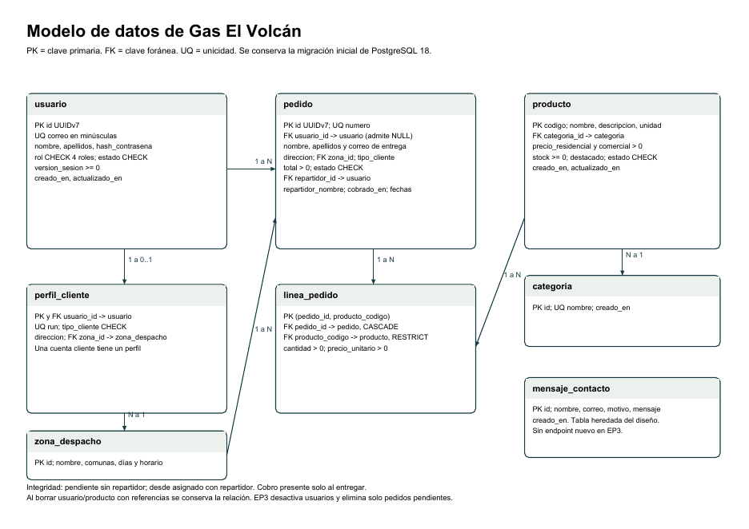
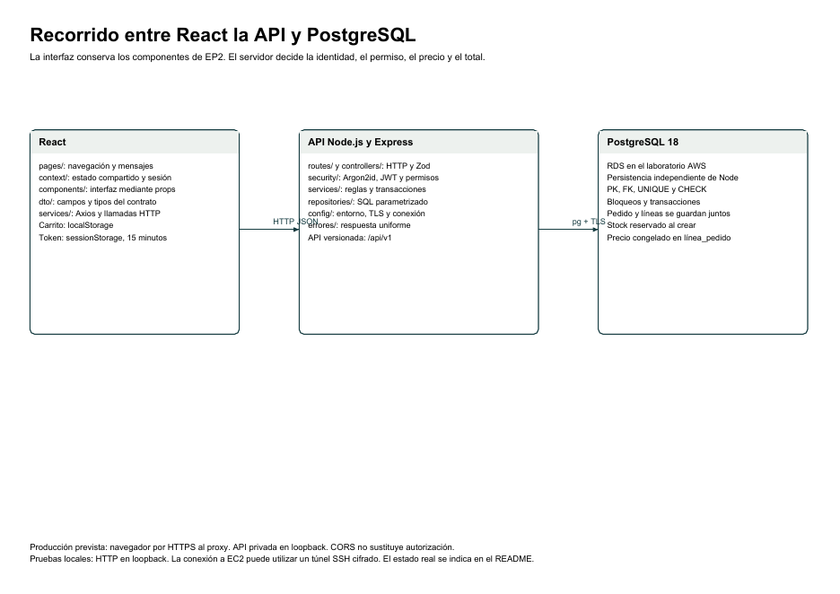

# Backend · Distribuidora de Gas El Volcán

API REST del sistema de pedidos de gas licuado de la Distribuidora de Gas El Volcán (caso Forma C).

| | |
|---|---|
| Asignatura | DSY1104 Desarrollo Fullstack II · Duoc UC · Sección 006D · 2026 |
| Integrante | Vicente Hueichapan Poblete |
| Frontend | [ProtecoFullstackllVolcan](https://github.com/vicenteehueichapan-boop/ProtecoFullstackllVolcan) |
| Aplicación desplegada | http://3.208.18.46:8080/ |
| Swagger (documentación viva) | http://3.208.18.46:8080/api/v1/docs/ |

## 1. Alcance

La distribuidora recibe entre 80 y 120 pedidos diarios por teléfono. El backend reemplaza el registro en cuadernos y los datos simulados del frontend de EP2 por una base de datos relacional con tres bloques:

1. **Usuarios, autenticación y roles:** registro, inicio de sesión con JWT, CRUD de usuarios y permisos por rol.
2. **Catálogo:** CRUD de cilindros y accesorios con tarifas residencial y comercial.
3. **Pedido de gas:** crear, listar, ver el detalle, asignar repartidor y cambiar el estado. Regla de conflicto: un pedido no pasa a «en camino» sin repartidor asignado (409).

Roles: **cliente**, **operadora**, **repartidor** y **administración**. Quedan para el examen final los reportes, el mantenimiento de categorías, los productos críticos, el perfil editable, el historial por usuario, los comprobantes y el mapa.

## 2. Estado del trabajo

| Área | Diseñado | Implementado | Probado |
|---|---|---|---|
| PostgreSQL, migración y semillas | Sí | Sí | Local y EC2/RDS |
| Registro, login, perfil y logout | Sí | Sí | Pruebas de integración, Swagger y navegador |
| CRUD de usuarios, roles y baja lógica | Sí | Sí | Pruebas de integración, Postman y navegador |
| CRUD de catálogo | Sí | Sí | Pruebas de integración y navegador |
| Pedidos: creación, asignación, estados y eliminación | Sí | Sí | Pruebas de integración y recorrido de los cuatro roles |
| Precio, stock y transacciones | Sí | Sí | Conflictos 409 y concurrencia de stock |
| Swagger / OpenAPI | Sí | Sí | Registro y login desde Swagger |
| Despliegue en EC2 con RDS | Sí | Sí | Servicio activo y acceso por IP |
| HTTPS público | Sí | No | Previsto para producción |

### Avance de la tabla de usuarios

| Operación | Estado | Endpoint |
|---|---|---|
| Tabla de usuarios | Listo | PostgreSQL con hash Argon2id; persiste tras reiniciar |
| Inicio de sesión | Listo | `POST /api/v1/auth/login` |
| Registro (crear usuario) | Listo | `POST /api/v1/auth/register` |
| Modificar usuario | Listo | `PATCH /api/v1/usuarios/{id}` |
| Listar usuarios | Listo | `GET /api/v1/usuarios` |
| Eliminar o desactivar usuario | Listo | `DELETE /api/v1/usuarios/{id}` (baja lógica) |

## 3. Decisiones técnicas

| Componente | Elección | Motivo |
|---|---|---|
| Lenguaje y framework | Node.js 24 y Express 5 | Mismo lenguaje que React y separación clara de rutas, servicios y datos. |
| Ejecución | EC2 (Ubuntu) con systemd y nginx | Proceso permanente que se reinicia ante fallos; nginx sirve React y la API en el mismo origen. Se evaluó Lambda con API Gateway, pero un solo proceso es más simple para el volumen del caso. |
| Base de datos | PostgreSQL 18 en Amazon RDS | Relaciones, restricciones y transacciones para pedidos y stock. Acceso privado desde EC2 con TLS verificado. |
| Acceso a datos | `pg` con SQL parametrizado y migraciones SQL versionadas | Control explícito de las consultas y protección contra inyección SQL. |
| Validación y DTO | Zod | Esquemas estrictos de entrada; los DTO de salida excluyen hashes y campos internos. |
| Contraseñas | `argon2` (Argon2id) | Algoritmo recomendado por OWASP para contraseñas. |
| JWT | `jose` (HS256) | Firma y verificación con validación de algoritmo, emisor, destinatario y vencimiento. |
| Protección HTTP | Helmet, CORS, express-rate-limit, Pino | Cabeceras seguras, orígenes permitidos, límite de intentos de login y registros sin datos sensibles. |
| Documentación | OpenAPI 3.1 y swagger-ui-express | Contrato versionado junto al código. |
| Pruebas | Vitest, Supertest y oxlint | Pruebas sobre una base PostgreSQL de pruebas separada. |

## 4. Diseño de datos



**Diagramas** (públicos en este repositorio, sin iniciar sesión): [entidad-relación](https://github.com/vicenteehueichapan-boop/BackendStackll/blob/main/docs/diagramas/entidad-relacion-ep3.png) · [React, API y base de datos](https://github.com/vicenteehueichapan-boop/BackendStackll/blob/main/docs/diagramas/arquitectura-ep3.png) · [secuencia de login y JWT](https://github.com/vicenteehueichapan-boop/BackendStackll/blob/main/docs/diagramas/secuencia-jwt-ep3.png).

La migración [`migrations/1731340800000_esquema-inicial.sql`](migrations/1731340800000_esquema-inicial.sql) es la referencia ejecutable del modelo.

- **usuario** guarda correo único, hash de contraseña, rol, estado y versión de sesión. **perfil_cliente** (1 a 0..1) agrega RUN único, tipo de cliente y zona.
- Una **categoría** tiene muchos **productos**; una **zona_despacho** tiene muchos perfiles y pedidos.
- Un cliente tiene muchos **pedidos**; un repartidor tiene muchas asignaciones. Un pedido tiene muchas **líneas**; la clave compuesta impide repetir un producto en el mismo pedido.
- Precios y total son enteros positivos en CLP; cantidades positivas; stock no negativo. El código de producto es único e inmutable.
- Desde «asignado» el pedido exige repartidor, y el cobro existe solo cuando está «entregado» (restricciones CHECK).
- Las claves foráneas usan RESTRICT: un usuario se desactiva en vez de borrarse y un producto con pedidos no se elimina (409). Eliminar un pedido pendiente borra sus líneas y devuelve el stock en la misma transacción.
- El propietario de un pedido se obtiene del JWT, nunca de un identificador enviado por el cliente.

**Datos iniciales.** Las semillas cargan los 14 productos, las categorías y las 5 zonas del frontend de EP2, y cinco cuentas ficticias del personal cuya contraseña se toma de una variable de entorno y se guarda como hash. Son repetibles y no sobrescriben cambios. Todo persiste al reiniciar el backend; solo el carrito vive en el navegador.

## 5. Organización y responsabilidades



| Carpeta | Responsabilidad |
|---|---|
| `src/routes/` y `src/controllers/` | Método y ruta HTTP, lectura de parámetros y estado de la respuesta. |
| `src/schemas/` | Validación de la entrada y forma de la salida (DTO). |
| `src/services/` | Reglas del negocio, propiedad de los registros y transacciones. |
| `src/repositories/` | Consultas SQL parametrizadas. |
| `src/security/` | Hash de contraseñas, emisión y verificación del JWT, autenticación y autorización. |
| `src/config/` | Variables de entorno validadas, conexión TLS, migraciones y registros. |
| `migrations/` y `seeds/` | Estructura de la base y datos ficticios iniciales. |

Vicente Hueichapan Poblete desarrolló el análisis, el modelo de datos, el backend, la integración con React, las pruebas y la documentación.

**Recorrido de una operación: confirmar pedido.** React envía `POST /api/v1/pedidos` con líneas, dirección y zona. Zod valida el cuerpo, `autenticar` identifica al cliente y `autorizar` exige el rol cliente. El servicio lee la tarifa del perfil, bloquea los productos con `FOR UPDATE`, comprueba precio y stock, calcula el total y guarda el pedido, sus líneas y el descuento de stock en una transacción. Responde 201; si el precio o el stock cambiaron responde 409 y no guarda nada. El navegador nunca decide el precio final, el rol ni el propietario.

## 6. API y documentación viva

Base `/api/v1`. El contrato completo (parámetros, ejemplos ficticios, respuestas, errores y permisos) está en [`docs/openapi.yaml`](docs/openapi.yaml) y se publica con Swagger UI.

- **Swagger en EC2:** http://3.208.18.46:8080/api/v1/docs/ · OpenAPI JSON: http://3.208.18.46:8080/api/v1/openapi.json
- **Swagger local:** http://localhost:3000/api/v1/docs/
- Para probar una ruta protegida: ejecutar `POST /auth/login`, copiar `accessToken`, presionar **Authorize** y pegarlo.

| Método y ruta | Permiso | Pantalla del frontend | Éxito |
|---|---|---|---|
| `POST /auth/register` | Público (rol cliente asignado por el servidor) | Registro | 201 |
| `POST /auth/login` | Público | Ingresar y Acceso del personal | 200 |
| `GET /auth/me` | Sesión válida | Restaurar sesión al recargar | 200 |
| `POST /auth/logout` | Sesión válida | Cerrar sesión | 204 |
| `GET /usuarios` | Administración | Administración › Usuarios | 200 |
| `POST /usuarios` | Administración | Crear cuenta del personal | 201 |
| `GET /usuarios/{id}` | Dueño de la cuenta o administración | Detalle de cuenta | 200 |
| `PATCH /usuarios/{id}` | Administración | Editar datos, rol y estado | 200 |
| `DELETE /usuarios/{id}` | Administración | Desactivar cuenta | 204 |
| `GET /productos` y `GET /productos/{codigo}` | Público | Catálogo y detalle | 200 |
| `POST /productos` | Administración | Administración › Productos | 201 |
| `PUT /productos/{codigo}` | Administración | Editar producto | 200 |
| `DELETE /productos/{codigo}` | Administración | Eliminar producto sin pedidos | 204 |
| `GET /pedidos` | Cliente: propios · Repartidor: asignados · Operadora y administración: todos | Mis pedidos, Pedidos del día, Mis entregas | 200 |
| `POST /pedidos` | Cliente | Confirmar pedido | 201 |
| `GET /pedidos/{id}` | Dueño, repartidor asignado, operadora o administración | Seguimiento | 200 |
| `PATCH /pedidos/{id}/asignacion` | Operadora o administración | Asignar repartidor | 200 |
| `PATCH /pedidos/{id}/estado` | Repartidor asignado, operadora o administración | Marcar en camino y entregado | 200 |
| `DELETE /pedidos/{id}` | Cliente dueño, operadora o administración (solo pendiente) | Eliminar pedido | 204 |
| `GET /categorias`, `GET /zonas` | Público | Filtros y formulario de entrega | 200 |
| `GET /repartidores` | Operadora o administración | Selector de repartidor | 200 |

**Errores:** 400 entrada inválida · 401 token ausente, alterado, vencido o revocado · 403 rol o propiedad insuficiente · 404 inexistente · 409 conflicto del negocio · 429 demasiados intentos de login. Formato: `{"error": {"codigo", "mensaje", "detalles"}}`.

Ejemplo ficticio de login:

```json
POST /api/v1/auth/login
{ "correo": "persona@ejemplo.cl", "contrasena": "UnaClaveFicticia2026!" }

200
{ "accessToken": "eyJ...", "tokenType": "Bearer", "expiresIn": 900 }
```

Con credenciales incorrectas la respuesta es el mismo 401, exista o no la cuenta. Nunca se devuelven contraseñas, hashes ni la clave de firma.

## 7. Seguridad

**Contraseñas.** Argon2id con 19 MiB de memoria, 2 iteraciones y paralelismo 1, con sal aleatoria por hash (configuración mínima recomendada por OWASP). Es un algoritmo lento y con costo de memoria, a diferencia de MD5 o SHA, lo que encarece los ataques por fuerza bruta. Las contraseñas se aceptan entre 8 y 128 caracteres y nunca se guardan ni registran en texto plano.


**JWT.** La API emite y verifica el token con HS256 y una clave aleatoria de al menos 32 bytes guardada en el `.env` del servidor (fuera de Git y de React). Se validan firma, algoritmo, emisor (`iss`), destinatario (`aud`) y vencimiento (`exp`). Claims: `sub`, `iss`, `aud`, `iat`, `exp`, `jti` y `ver`. El rol no viaja en el token: se lee de la base en cada solicitud, así un cambio de rol o una desactivación rige de inmediato.

**Vigencia y cierre.** El token dura 15 minutos y no hay refresh token: al vencer se inicia sesión de nuevo. El logout incrementa `version_sesion` en la base y revoca los tokens emitidos antes; lo mismo ocurre al modificar o desactivar una cuenta.

**Sesión en el frontend.** React guarda el token en `sessionStorage` para cumplir la persistencia tras recargar, y al iniciar consulta `/auth/me` para obtener los permisos vigentes. `sessionStorage` es legible por JavaScript ante un XSS, por eso la vigencia es corta, no se inserta HTML recibido y la sesión se borra al cerrar la pestaña, al cerrar sesión o al recibir 401.

**Permisos.**

| Operación | Cliente | Operadora | Repartidor | Administración |
|---|---|---|---|---|
| Ver catálogo | Sí | Sí | Sí | Sí |
| Crear pedido | Propio | No | No | No |
| Consultar pedidos | Propios | Todos | Asignados | Todos |
| Asignar repartidor | No | Sí | No | Sí |
| Cambiar estado | No | Sí | Solo asignados | Sí |
| Eliminar pedido pendiente | Propio | Sí | No | Sí |
| Productos, cuentas y roles | No | No | No | Sí |

Solo administración asigna roles. Cambiar el identificador en la URL no permite ver ni modificar registros ajenos (403). React oculta menús y rutas según el rol, y el servidor vuelve a comprobar cada permiso.

**Otros controles.** Límite de 5 intentos fallidos por cuenta y 20 por IP cada 15 minutos. CORS permite solo los orígenes configurados y no reemplaza la autorización. Los registros ocultan contraseñas y tokens. RDS no es público y la conexión usa TLS verificado. La demostración por IP usa HTTP en el puerto 8080, limitado por el grupo de seguridad y con cuentas ficticias; en producción se exige HTTPS.

## 8. Cómo ejecutar

### Local

Requisitos: Node.js 24 y PostgreSQL 18.

```bash
npm ci
cp .env.example .env          # completar credenciales, JWT_SECRETO y SEMILLA_CONTRASENA_DEMO
npm run migrar
npm run sembrar
npm start                     # http://localhost:3000/api/v1/docs/
```

Generar la clave JWT: `node -e "console.log(require('crypto').randomBytes(32).toString('base64'))"`. Para PostgreSQL local usar `DB_TLS=local`; para RDS, `DB_TLS=verify` con el certificado de AWS en `DB_CA_PATH`.

### EC2

1. Iniciar el laboratorio de AWS Academy y verificar que la instancia EC2 y la base RDS estén activas. La IP pública cambia al reiniciar el laboratorio.
2. En el grupo de seguridad, permitir el puerto 8080 desde la IP de la red donde se presentará («Mi IP»).
3. Copiar el proyecto, ejecutar `npm ci --omit=dev`, crear el `.env` privado (permisos 600), `npm run migrar` y `npm run sembrar`.
4. Instalar el servicio [`deploy/gas-el-volcan-api.service`](deploy/gas-el-volcan-api.service) y la configuración nginx del repositorio del frontend.
5. Comprobar: `systemctl is-active gas-el-volcan-api`, `sudo nginx -t` y `curl http://127.0.0.1:8080/api/v1/productos`.

## 9. Pruebas

Las pruebas usan `.env.test` con una base cuyo nombre termina en `_test` (el ejecutor rechaza otro nombre).

```bash
npm test -- --maxWorkers=1 --no-file-parallelism
npm run lint
npm audit --omit=dev
```

Resultado: **44 pruebas aprobadas** en cuatro archivos, contra PostgreSQL local y EC2/RDS; lint sin errores; 0 vulnerabilidades. El CRUD de usuarios se comprobó además en Postman contra EC2/RDS (7 solicitudes, 0 fallos).

| Caso | Esperado | Resultado |
|---|---|---|
| Login válido / inválido / cuenta inexistente | 200 con Bearer 900 s / 401 genérico idéntico | Conforme |
| Registro inválido / duplicado / con rol enviado | 400 / 409 / 400 | Conforme |
| Ruta protegida sin token o con token alterado | 401 | Conforme |
| Token vencido, destinatario incorrecto o algoritmo no permitido | Rechazo | Conforme |
| Rol insuficiente, cuenta o pedido ajeno | 403 | Conforme |
| Logout, baja y cambio de rol | Token anterior revocado | Conforme |
| CRUD de usuarios y productos | 201 / 200 / 204 y 404 | Conforme |
| Último administrador o repartidor con entregas | 409 | Conforme |
| Pedido válido / stock insuficiente / precio cambiado | 201 / 409 sin cambios | Conforme |
| Dos compras simultáneas con stock limitado | Una se guarda, la otra 409 | Conforme |
| En camino sin repartidor / secuencia incorrecta | 409 | Conforme |
| Eliminar producto con pedidos o pedido en curso | 409 | Conforme |
| Eliminar pedido pendiente | 204 y stock devuelto | Conforme |

**Pendiente:** HTTPS público (previsto para producción).

## 10. Checklist Guía 19

- [x] Repositorio nuevo para el backend y frontend separado.
- [x] README con proyecto, caso, alcance e integrante.
- [x] Enlaces cruzados entre los README del backend y del frontend.
- [x] Tecnología y ejecución en EC2 justificadas.
- [x] Base de datos y diagrama entidad-relación actualizados, sin diccionario de datos.
- [x] Diagramas con enlace directo y acceso de lectura público, versionados en [`docs/diagramas/`](docs/diagramas/).
- [x] Responsabilidades del backend y del integrante.
- [x] Estructura, conexión a datos y endpoints con estado real.
- [x] OpenAPI/Swagger con instrucciones para consultar y probar.
- [x] Operaciones de la API relacionadas con las pantallas del frontend.
- [x] Protección de contraseñas investigada y justificada, sin credenciales reales.
- [x] Flujo JWT y permisos con controles implementados y pendientes.
- [x] Diagrama de secuencia propio con casos de rechazo.
- [x] Pruebas reales separadas de los casos pendientes.
- [x] Pasos para ejecutar, desplegar y comprobar.

## 11. Fuentes

- [OWASP Password Storage Cheat Sheet](https://cheatsheetseries.owasp.org/cheatsheets/Password_Storage_Cheat_Sheet.html)
- [OWASP REST Security Cheat Sheet](https://cheatsheetseries.owasp.org/cheatsheets/REST_Security_Cheat_Sheet.html)
- [RFC 7519 (JWT)](https://www.rfc-editor.org/rfc/rfc7519) y [RFC 8725 (buenas prácticas JWT)](https://www.rfc-editor.org/rfc/rfc8725)
- [Documentación de PostgreSQL 18](https://www.postgresql.org/docs/18/)
- [AWS: TLS con RDS PostgreSQL](https://docs.aws.amazon.com/AmazonRDS/latest/UserGuide/PostgreSQL.Concepts.General.SSL.html)
- [Swagger](https://swagger.io/docs/), [jose](https://github.com/panva/jose), [node-argon2](https://github.com/ranisalt/node-argon2), [node-postgres](https://node-postgres.com/)
