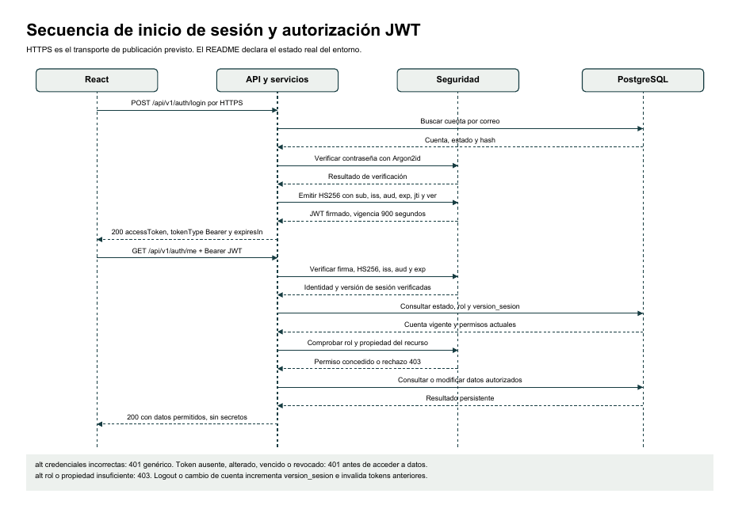

# Backend · Distribuidora de Gas El Volcán

DSY1104 Desarrollo Fullstack II · Duoc UC · sección 006D · 2026. Caso Forma C. Vicente Hueichapan Poblete, trabajo individual.

Continuidad del frontend de la unidad 2. Este README actualiza el plan de la **Guía 19** y la solicitud de avance/EP3 al **20 de noviembre de 2026**. El avance original permanece en el historial.

**Frontend:** [ProtecoFullstackllVolcan](https://github.com/vicenteehueichapan-boop/ProtecoFullstackllVolcan).

## 1. Alcance y estado real

La distribuidora recibe 80 a 120 pedidos diarios y necesita controlar catálogo, existencias, asignación y entrega. Flujo: cliente registrado confirma → operadora asigna → repartidor inicia recorrido y entrega → se registra cobro en efectivo. Administración mantiene productos y cuentas.

| Área | Diseñado | Implementado | Comprobación real |
|---|---|---|---|
| PostgreSQL 18, migración y semillas | Sí | Sí | Local y EC2/RDS |
| Registro, login, perfil y logout | Sí | Sí | Integración y navegador |
| CRUD usuarios, roles y baja lógica | Sí | Sí | Integración y administración React |
| CRUD catálogo | Sí | Sí | Integración y navegador |
| CRUD pedidos, asignación y estados | Sí | Sí | Integración y recorrido de los cuatro roles |
| Precio, stock y transacción | Sí | Sí | Conflictos 409 y concurrencia sobre stock |
| Sesión tras recarga, cierre y vencimiento | Sí | Sí | Vitest; recarga/cierre en navegador |
| Swagger/OpenAPI | Sí | Sí | 200 y registro/login desde Swagger |
| API con systemd en EC2 | Sí | Sí | Servicio activo, catálogo/login/perfil correctos |
| React compilado y proxy nginx | Sí | Sí | Acceso por túnel SSH, ver ejecución |
| HTTPS público con dominio | Sí | No | Pendiente; demostración por SSH cifrado |

No se implementan los módulos reservados al examen: reportes, mantenimiento de categorías, productos críticos, perfil editable, historial administrativo por usuario, comprobantes y mapa. Categorías y zonas tienen lectura para los formularios. Las vistas informativas de EP2 se conservan; Contacto continúa como simulación local, fuera de los tres bloques de API evaluados.

## 2. Decisiones técnicas

| Componente | Elección y motivo |
|---|---|
| Lenguaje/framework | Node.js 24 y Express 5: JavaScript común con React y separación explícita de responsabilidades. Versiones exactas en el lockfile. |
| Infraestructura | EC2 Ubuntu, instancia lab-springboot; systemd inicia y reinicia el proceso. EC2 es infraestructura, Express es framework. |
| Datos | PostgreSQL 18 en RDS: relaciones, integridad y transacciones para pedidos/stock. Se requiere versión 18 por uuidv7(). |
| Acceso a datos | pg, SQL parametrizado y migraciones SQL transaccionales versionadas; sin persistencia de negocio en memoria. |
| DTO y validación | Zod valida parámetros y cuerpos estrictos. Los DTO de salida excluyen hashes y campos internos. |
| Seguridad | argon2, jose, Helmet, CORS, límites de login y Pino con ocultamiento de datos sensibles. |
| Contratos | OpenAPI 3.1 y Swagger UI; especificación versionada junto al código. |
| Pruebas/calidad | Vitest, Supertest, PostgreSQL de pruebas, oxlint y auditoría de dependencias. |

Se evaluó Lambda con API Gateway: exige organizar funciones, entrada HTTP y acceso a RDS; los datos seguirían persistiendo fuera de la función. Se elige EC2 para continuar el laboratorio y mantener un proceso sencillo para el volumen del caso. RDS usa TLS con CA verificada. Credenciales y llave SSH permanecen fuera de Git y React.

## 3. Modelo de datos


La migración en migrations/ es la referencia ejecutable. Se incluyen atributos principales y restricciones, sin diccionario de datos.

- usuario: correo único, hash, rol, estado y versión de sesión. perfil_cliente: relación 1 a 0..1, RUN único, tarifa y zona opcional.
- Una categoría tiene muchos productos. Una zona tiene muchos perfiles/pedidos. Un pedido contiene muchas líneas, cada una referencia un producto; la PK compuesta impide repetirlo.
- Un cliente tiene muchos pedidos; un repartidor tiene muchas asignaciones. La API obtiene el propietario desde el JWT, nunca desde un clienteId enviado.
- Precios y total son enteros positivos en CLP; cantidades positivas y stock no negativo. Correo normalizado a minúsculas y código de producto único e inmutable.
- FK RESTRICT conserva usuarios/productos referenciados. Usuario se deshabilita; borrar producto usado devuelve 409. Eliminar pendiente borra sus líneas por CASCADE y devuelve stock en la misma transacción.
- Desde asignado se requiere repartidor y nombre de asignación. El cobro existe exactamente al estar entregado.
- El esquema inicial conserva mensaje_contacto y usuario_id nullable para pedidos históricos. EP3 no expone mensajes ni permite nuevos pedidos anónimos: exige sesión cliente. Esta adaptación a los roles de la evaluación se explicita en la ERS V3.

Las semillas trasladan las 14 referencias del catálogo React, categorías y zonas. Son repetibles y no sobrescriben cambios. La contraseña de cinco perfiles ficticios del personal se configura por entorno y se hashea antes de insertarse. Usuarios, hashes, versiones de sesión, catálogo, pedidos, líneas y cobros sobreviven al reinicio. Solo el carrito permanece en el navegador.

**Drive:** los permisos de lectura del docente quedan sin verificar. Los tres diagramas están versionados como imágenes y se entregan también en PDF separado. No se acredita un enlace de Drive accesible.

## 4. Organización y responsabilidades


| Carpeta | Responsabilidad |
|---|---|
| routes/ y controllers/ | Método/ruta, validación de parámetros/cuerpo y estado HTTP. |
| schemas/ | Campos permitidos, formato, longitudes y rangos. |
| services/ | Reglas del negocio, propiedad y coordinación transaccional. |
| repositories/ | SQL parametrizado sobre pool o cliente transaccional. |
| security/ | Hash, JWT, autenticación y autorización. |
| config/ | Entorno validado, TLS, pool, migraciones y logs. |
| migrations/ y seeds/ | Estructura persistente y datos ficticios iniciales. |

Vicente Hueichapan asume análisis, modelado, código de ambas aplicaciones, pruebas y documentación. No se atribuyen tareas a integrantes inexistentes.

**Recorrido completo: confirmar pedido.** ConfirmarPedido valida entrega y llama a pedidosApi; su DTO envía contacto, dirección, zona y líneas con código, cantidad y precio mostrado. Zod valida estructura y autenticación identifica al cliente. El servicio lee su tarifa de la base, bloquea productos en orden estable con FOR UPDATE y comprueba disponibilidad, precio vigente y stock. Calcula precios/total, inserta pedido/líneas y descuenta stock en una transacción. Devuelve 201; React limpia carrito y muestra confirmación. Si cambió precio o stock devuelve 409 y revierte todo. El navegador no decide rol, propietario ni precio final.

## 5. API y pantallas

Base **/api/v1**. [OpenAPI](docs/openapi.yaml) contiene por operación parámetros, JSON ficticios de entrada/salida, validaciones, respuestas, errores y permisos. Las operaciones documentadas están implementadas; no se presentan rutas propuestas como disponibles.

| Método y ruta relativa | Permiso / pantalla | Entidades / éxito |
|---|---|---|
| POST /auth/register | Público; Registro. Asigna cliente, rechaza rol enviado | usuario, perfil_cliente / 201 |
| POST /auth/login | Público; Ingreso y Acceso personal | usuario / 200 Bearer con vigencia |
| GET /auth/me | Sesión válida; restaurar al recargar | usuario, perfil_cliente / 200 |
| POST /auth/logout | Sesión válida; Cerrar sesión | version_sesion / 204 |
| GET /usuarios | Administración; tabla de cuentas | usuario / 200 |
| POST /usuarios | Administración; crear personal | usuario / 201 |
| GET /usuarios/{id} | Propietario o administración | usuario / 200 |
| PATCH /usuarios/{id} | Administración; editar datos, rol/estado | usuario / 200 |
| DELETE /usuarios/{id} | Administración; deshabilitar | usuario / 204 |
| GET /productos | Público; catálogo, carrito y destacados. Filtros busqueda/categoria | producto, categoria / 200 |
| GET /productos/{codigo} | Público; detalle | producto, categoria / 200 |
| POST /productos | Administración; crear | producto / 201 |
| PUT /productos/{codigo} | Administración; reemplazar campos, código estable | producto / 200 |
| DELETE /productos/{codigo} | Administración; eliminar sin referencias | producto / 204 |
| GET /pedidos | Cliente propios, repartidor asignados, operadora/admin todos | pedido, linea_pedido, zona / 200 |
| POST /pedidos | Cliente; Confirmar pedido | pedido, lineas, producto / 201 |
| GET /pedidos/{id} | Propietario/asignado u operadora/admin; detalle | pedido, lineas / 200 |
| PATCH /pedidos/{id}/asignacion | Operadora/admin; selector | pedido, usuario repartidor / 200 |
| PATCH /pedidos/{id}/estado | Repartidor asignado u operadora/admin | pedido / 200 |
| DELETE /pedidos/{id} | Cliente dueño u operadora/admin; solo pendiente | pedido, lineas, producto / 204 |
| GET /categorias y /zonas | Público; filtros/formulario | categoria, zona_despacho / 200 |
| GET /repartidores | Operadora/admin; asignación | usuario repartidor activo / 200 |

id debe ser UUID; codigo tiene dos letras mayúsculas y tres números. Entrada inválida: 400; token ausente, alterado, vencido o revocado: 401; rol/propiedad insuficiente: 403; inexistente: 404; duplicados/conflictos del caso: 409; límite de login: 429. Error JSON: error.codigo, error.mensaje y error.detalles por campo cuando corresponde. Sin registros se devuelve lista vacía.

DELETE usuario es baja lógica para conservar relaciones. La actualización de pedido se expresa por asignación/estado; no reescribe cobro ni precio histórico. Último administrador, conversión cliente-personal o repartidor con entregas pendientes: 409. Crear cliente corresponde al registro público; crear personal exige administración.

Ejemplo ficticio de login:

```json
{ "correo": "persona@ejemplo.cl", "contrasena": "UnaClaveFicticia2026!" }
```

Respuesta 200: accessToken generado, tokenType Bearer, expiresIn 900 y usuario público. Credenciales incorrectas: mismo 401 exista o no la cuenta. Nunca se devuelven contraseñas, hashes o clave de firma.

### Swagger: direcciones reales

- Desarrollo: [Swagger UI](http://localhost:3000/api/v1/docs/) y [OpenAPI JSON](http://localhost:3000/api/v1/openapi.json).
- EC2 por túnel SSH: [Swagger UI](http://localhost:8080/api/v1/docs/) y [OpenAPI JSON](http://localhost:8080/api/v1/openapi.json). Son direcciones locales al equipo que abre el túnel; no una URL pública.
- Ejecutar login, copiar accessToken en Authorize y probar según rol. Swagger no conserva autorización al cerrar. Los resultados comprobados figuran abajo.

## 6. Seguridad, sesión y roles

**Argon2id**, biblioteca argon2: memoria 19 MiB, dos iteraciones y paralelismo 1; sal aleatoria por hash. Diseñado para contraseñas y con costo de memoria, siguiendo la alternativa mínima de OWASP citada al final. Regla de entrada del proyecto: 8 a 128 caracteres. No se guarda ni registra texto plano.



La API emite y verifica JWT **HS256** con jose y clave aleatoria de al menos 32 bytes fuera de Git. Valida firma, algoritmo, expiración, emisor y destinatario. Claims: sub, iss, aud, iat, exp, jti y ver (revocación por versión). No contiene rol ni datos sensibles; estado y rol se consultan en cada solicitud. La firma da integridad, no cifra contenido.

Vigencia: **900 segundos**, para limitar exposición. Sin refresh token: al vencer se inicia sesión de nuevo. Logout incrementa version_sesion en la base y revoca las copias anteriores de la cuenta. Cambios de usuario y baja incrementan versión; una cuenta inactiva se rechaza inmediatamente. Cerrar sesión afecta todos los tokens anteriores de esa cuenta.

React usa **sessionStorage** para cumplir recarga en EP3. Al iniciar consulta /auth/me y recupera permisos del servidor; limpia al expirar, recibir 401 o cerrar. sessionStorage es accesible ante XSS: se limita vigencia, no se usa HTML sin sanear ni se coloca el token en localStorage; cerrar pestaña elimina sesión. No equivale a una cookie HttpOnly. El carrito sí usa localStorage.

| Operación | Cliente | Operadora | Repartidor | Administración |
|---|---|---|---|---|
| Catálogo/detalle | Sí | Sí | Sí | Sí |
| Crear pedido | Propio | No | No | No |
| Consultar pedidos | Propios | Todos | Asignados | Todos |
| Asignar repartidor | No | Sí | No | Sí |
| Cambiar estado | No | Sí | Solo asignado | Sí |
| Eliminar pendiente | Propio | Sí | No | Sí |
| Productos/cuentas/roles | No | No | No | Sí |

Cambiar el ID no permite consultar cuentas/pedidos ajenos. React acompaña permisos con rutas/menús; el servidor vuelve a comprobarlos. CORS permite orígenes configurados, actualmente http://localhost:5173; nginx usa mismo origen. CORS no es autorización. Logs excluyen contraseñas/tokens y login limita intentos.

RDS usa TLS verificado y la demostración remota usa SSH cifrado. HTTPS público con certificado/dominio está previsto y pendiente: no se transmiten tokens por un puerto HTTP público.

## 7. Ejecutar y comprobar

### Desarrollo

1. Node.js 24 y PostgreSQL 18; bases gas_el_volcan y gas_el_volcan_test separadas, usuario con permisos.
2. npm ci.
3. Copiar .env.example a .env y completar credenciales y clave JWT. RDS: DB_TLS=verify y CA; PostgreSQL en loopback: DB_TLS=local sin CA. El modo local rechaza hosts remotos.
4. npm run migrar; npm run sembrar con SEMILLA_CONTRASENA_DEMO configurada. No sobrescribe cuentas existentes.
5. npm start: escucha por defecto en 127.0.0.1:3000. Abrir Swagger y ejecutar React según su README.

Clave JWT: generar localmente con `node -e "console.log(require('crypto').randomBytes(32).toString('base64'))"`. Guardar solo en entorno privado; nunca VITE_.

### EC2: demostración por túnel cifrado

Instancia lab-springboot. IP comprobada el 20-nov-2026: **18.209.18.21**; cambia al reiniciar el laboratorio. La llave está fuera del repositorio.

```bash
ssh -i RUTA_A_LA_LLAVE -N -L 127.0.0.1:8080:127.0.0.1:8080 ubuntu@18.209.18.21
```

Mantener terminal abierta y visitar **http://localhost:8080**. React, API y Swagger comparten origen. Nginx escucha en loopback:8080 y Node en loopback:3001. No requiere puertos públicos nuevos ni publicar RDS. SSH cifra el tramo entre equipos; HTTP queda en loopback.

Instalación activa: /home/ubuntu/BackendStackll-EP3-20261120; .env privado con permisos 600. Node 24.19.0 en /home/ubuntu/.local/node-v24.19.0-linux-x64/bin/node. Servicio gas-el-volcan-api.service con override ep3.conf. Se conserva /home/ubuntu/BackendStackll para reversión. React en /var/www/gas-volcan-ep3 y proxy nginx a 3001. Archivos de configuración en deploy/ de ambos repositorios. Antes de reemplazar una versión: instalar dependencias, migrar y probar en base _test; reiniciar solo después de aprobar.

Comprobar desde EC2: `systemctl is-active gas-el-volcan-api`, `sudo nginx -t`, `curl http://127.0.0.1:8080/api/v1/productos`. AWS Academy, EC2, RDS y túnel deben estar activos para presentar.

## 8. Pruebas reales

Configurar .env.test con una base terminada en _test. El ejecutor rechaza otro nombre. Los casos crean/limpian datos ficticios.

```bash
npm test -- --maxWorkers=1 --no-file-parallelism
npm run lint
npm audit --omit=dev
```

**20-nov-2026:** 43 pruebas aprobadas en cuatro archivos, local PostgreSQL 18 y EC2/RDS. Lint: 0 errores/advertencias. Auditoría de ejecución: 0 vulnerabilidades detectadas en esa fecha.

| Caso | Esperado | Resultado |
|---|---|---|
| Login válido/inválido/cuenta inexistente | 200 Bearer 900 s / 401 genérico idéntico | Conforme |
| Registro inválido/duplicado/rol extra | 400/409 sin duplicado/400 | Conforme |
| Sin token o alterado | 401 | Conforme |
| Vencido, aud incorrecto, algoritmo no permitido | Rechazo criptográfico | Conforme, unitarias |
| Rol, cuenta o pedido ajeno | 403 | Conforme |
| Logout, baja y cambio de rol | Revocación del token anterior | Conforme |
| CRUD usuarios/productos | Persistencia, 201/200/204 y 404 | Conforme |
| Último administrador o repartidor ocupado | 409 sin estado inválido | Conforme |
| Pedido válido/stock insuficiente | 201/409 transaccional | Conforme |
| Concurrencia de stock limitado | Una venta, otra en conflicto | Conforme |
| Precio cambiado/sin repartidor/secuencia incorrecta | 409 | Conforme |
| Eliminar producto usado o pedido en curso | 409 | Conforme |
| Eliminar pendiente | 204 y stock devuelto | Conforme |
| Servicio activo RDS | catálogo/OpenAPI 200, sin token 401, login/me 200 | Conforme |

React: **27 pruebas, 12 archivos**, lint sin errores y compilación correcta. Cobertura global de instrucciones: **25,52 %**, no cobertura completa. Navegador: registro, recarga, confirmación, asignación, entrega/cobro, bloqueo por rol, alta/edición/baja de personal y CRUD de producto. Tras reiniciar el backend local, el pedido entregado permaneció. Catálogo a 360/768/1280 px sin desbordamiento de página. Manual e integración se entregan separados del código.

Pendientes: Drive con acceso docente verificado, HTTPS público, ensayo individual y carga en AVA. No se acreditan mediante estas pruebas.

## 9. Plan y seguimiento

Plan de dos semanas: base del 11 de noviembre (datos, autenticación, catálogo lectura); incremento del 20 completa usuarios, catálogo, pedidos, React y documentación EP3. No se alteran fechas de commits.

Dificultades resueltas: IP EC2 cambiante, Node 24, DTO entre React/SQL, conflicto FK al borrar producto usado, y separación de precio mostrado/cálculo del servidor. Próximos pasos académicos: ensayar explicación con código y cargar AVA antes del 29-nov a las 23:59; cierre de usuarios 22-nov a las 23:59. Fecha de presentación por confirmar en el curso.

## 10. Checklist Guía 19

- [x] Backend separado, enlaces recíprocos e identificación del caso/integrante.
- [x] Tecnología, EC2, base de datos y herramientas justificadas.
- [x] ER actualizado, restricciones y explicación sin diccionario.
- [ ] Acceso docente verificado en Drive.
- [x] Capas y responsabilidad del integrante explicadas.
- [x] Estructura, conexión y endpoints con estado real.
- [x] OpenAPI/Swagger y relación con pantallas.
- [x] Hash, JWT, roles, vigencia y revocación con fuentes.
- [x] Secuencia propia con rechazos.
- [x] Pruebas reales separadas de pendientes.
- [x] Ejecución reproducible y plan de dos semanas.
- [ ] Integrante ha ensayado todas las decisiones y el código.

## 11. Fuentes

- [OWASP Password Storage](https://cheatsheetseries.owasp.org/cheatsheets/Password_Storage_Cheat_Sheet.html): Argon2id y sus parámetros.
- [OWASP REST Security](https://cheatsheetseries.owasp.org/cheatsheets/REST_Security_Cheat_Sheet.html): JWT, permisos y transporte.
- [RFC 7519](https://www.rfc-editor.org/rfc/rfc7519) y [RFC 8725](https://www.rfc-editor.org/rfc/rfc8725).
- [PostgreSQL 18](https://www.postgresql.org/docs/18/): transacciones, restricciones y UUID.
- [AWS: TLS con RDS PostgreSQL](https://docs.aws.amazon.com/AmazonRDS/latest/UserGuide/PostgreSQL.Concepts.General.SSL.html).
- [Swagger](https://swagger.io/docs/), [Axios](https://axios-http.com/docs/intro), [jose](https://github.com/panva/jose), [node-argon2](https://github.com/ranisalt/node-argon2).
- DSY1104: Guías 19/20, solicitud avance/EP3, caso Forma C y ERS V2/V3. El texto recibido de la Guía 19 conserva un pie con número 18; se sigue la numeración indicada en el curso.
